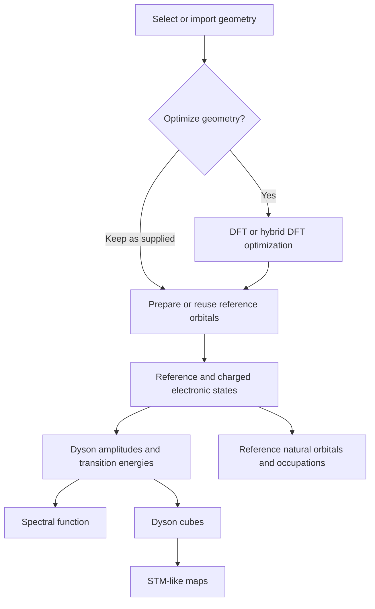

# AiiDAlab ORCA: molecular spectroscopy

**Status: first local geometry prototype.** Following the [design discussion](https://github.com/nanotech-empa/aiidalab-orca/issues/1), implementation has started with a small geometry WorkChain and a separate AiiDAlab interface. The broader spectroscopy design below remains under review. CASCI, Dyson orbitals, spectral blends, and electronic-artifact recovery are not implemented yet.

The geometry prototype supports structure import/editing (including the shared CDXML importer), searchable calculation history, explicit charge/multiplicity, HF or DFT optimization with optional Cartesian/distance/angle/dihedral constraints, keeping a supplied geometry, provenance-based result reuse, and a molecular trajectory/energy viewer. See [the geometry implementation and local setup guide](docs/geometry.md). The backend is separately installable from `backend/` and usable without the app. The local starting test is **NO, neutral doublet, PBE/def2-SVP**; pentacene remains the spectroscopy reference target.

Geometry is the first working example of **property → YAML protocol → GUI
overrides → reviewed effective input**. [Versioned starting protocols](backend/src/aiida_empa_orca/protocols/geometry.yaml)
hold scientific defaults, following the packaged-protocol approach used by
`aiida-nanotech-empa`. The GUI edits a per-run copy and previews the generated
ORCA input; stored runs retain their resolved settings and actual CalcJob input.
Method/basis suggestions are editable, with advanced reference, convergence,
RI, grid, dispersion, element-specific basis/ECP and scalar scientific controls.
These remain starting protocols for review, not universal accuracy guarantees.

**The next scientific priority is the Dyson pipeline**, not a general-purpose
ORCA input editor. Next come a separate reference-state step with a checked
wavefunction-artifact contract, followed by CASCI in the common orbital basis,
Dyson amplitudes/energies, and the spectrum plus energy-selected map viewer.
Reference-wavefunction import/recovery and nested property blocks belong to those
components. The geometry example provides the protocol, override, provenance
and reuse pattern to review with Andrés and Eve before extending it.

The intended application would let a researcher start from a molecular geometry, optionally optimize it with DFT or hybrid DFT, and calculate selected molecular properties such as natural orbitals, electron-addition/removal spectra, and Dyson-orbital maps. Existing compatible results should be reusable at every stage.

The scientific plan and implementation should continue to be reviewed with [Andrés Ortega-Guerrero](https://github.com/AndresOrtegaGuerrero). Please keep initial feedback in the design-review issue under [Issues](https://github.com/nanotech-empa/aiidalab-orca/issues), referring to the relevant README section. This is a request for design and scientific review; it is not an assignment to implement the proposal.

## 1. Starting requirements

These requirements capture the initial discussion and are open to refinement with Andrés:

- Provide an AiiDAlab-QE-like flow: select a structure, configure the calculation and properties, review the execution plan, submit, and explore results.
- Allow the supplied geometry to be kept exactly as it is, including a geometry already optimized elsewhere or in a previous AiiDA calculation.
- Offer optional molecular geometry optimization using conventional DFT or hybrid DFT. Agree on supported methods and protocols before choosing defaults.
- Let the user request individual properties and return later to compute additional properties for the same structure.
- Reuse compatible calculations and their outputs through explicit provenance links and checks of the data and files needed by the next step. Inspect the remote folder or, when appropriate, the retrieved folder and other stored output data. Reuse must work across separate app sessions and independent workflow submissions, with AiiDA caching either enabled or disabled.
- Explain which steps will run, which results will be reused, and why any calculation has to be repeated.
- Preserve the connection between structures, calculations, files, and derived results through AiiDA provenance.
- Build small, flexible scientific workflows that can be used separately and combined. Avoid one large workflow that owns every scientific task.
- Develop and validate this reuse and recovery design in this app first. If it proves useful, adapt the validated approach for other EMPA apps later.

**Interface design baseline:** use [AiiDAlab-QE](https://github.com/aiidalab/aiidalab-qe)
as the reference for section organization, step confirmation and validation,
importers/editors, computational resources, submission, search, and results.
Reuse maintained shared widgets and applicable QE patterns before introducing
custom ones. Any departure should meet an ORCA-specific need or demonstrate a
usability improvement, with its rationale and browser validation recorded. The
draft interface is not yet a claim of parity; the next UI cleanup should compare
the same user tasks against QE, including returning to earlier steps and
invalidating dependent settings after an edit.

## 2. Scientific scope to agree

The initial motivating example combines three kinds of output:

1. Reference-state natural orbitals and their occupations.
2. An electron-addition/removal spectral function, with transition energies and Dyson pole strengths.
3. Individual or summed Dyson-orbital maps at selected heights above a molecule.

The supplied prototype uses a DFT reference followed by CASCI calculations for the reference electron count N and the charged sectors N−1 and N+1. The states are intended to share a common orbital basis. ORCA output and wavefunction JSON are then processed with `dyson-orca-tools`; Dyson cubes are used by `meqpy` to obtain constant-height STM-like maps.

This diagram describes dependencies, not a mandatory sequence to execute on every submission. A user with appropriate existing data should be able to enter at any relevant stage.

### First testing target: pentacene

**Pentacene is the agreed spectroscopy reference target for design and subsequent testing.** The first geometry implementation uses the smaller neutral NO doublet for quick local integration tests. The user-supplied starting geometry is included as [`examples/pentacene/pentacene.xyz`](examples/pentacene/pentacene.xyz). The XYZ contains 36 atoms (C22H14), all in the xy plane. This file has not yet been verified as an optimized geometry or as the exact geometry used in the publication.

The scientific reference is Kumar et al., *Multireference Theory of Scanning Tunneling Spectroscopy Beyond One-Electron Molecular Orbitals: Can We Image Molecular Orbitals?*, **J. Am. Chem. Soc. 147**, 24993–25003 (2025), [DOI: 10.1021/jacs.5c08166](https://doi.org/10.1021/jacs.5c08166) ([user-supplied article link](https://pubs.acs.org/jacsat/article/147/28/24993/3738262/Multireference-Theory-of-Scanning-Tunneling)).

The paper describes pentacene using closed-shell PBE0 reference orbitals and CASCI(12,12), and presents natural orbitals, Dyson orbitals, and strengths. Its simulated tunneling maps use PP-STM/PP-SPM. These are useful reference choices for discussion; the supplied M062X/CAS(14,14) setup and meqpy map model must not be assumed to reproduce that protocol automatically. [Paper and methods](https://pubs.acs.org/doi/10.1021/jacs.5c08166)

We should agree with Andrés on two levels of testing: an inexpensive pipeline check using the supplied pentacene structure, and a numerical comparison with the publication using matched geometry, electronic-structure settings, and map assumptions. The initial target is to compare reference occupations, transition energies and strengths, spectra, and selected map shapes. Exact settings, reference outputs, and acceptance tolerances remain to be established from the paper, its supporting information, and the discussion. Both keeping the supplied geometry and optionally optimizing it should be covered in the eventual workflow tests.

### Questions for scientific review

- Which pentacene geometry, basis, active orbitals, input settings, and numerical reference results should define the publication-comparison test?
- Should the first supported case be a singlet reference with doublet final states, a triplet with doublet/quartet final states, or both? The supplied command and illustrative figure use different reference multiplicities.
- Is the first release limited to CASCI in a shared orbital basis? Separately optimized CASSCF orbitals would require their own validation and reuse rules.
- How should the active orbitals be selected, inspected, and recorded? An active-space size such as CAS(14,14) alone does not identify the scientifically appropriate orbitals.
- Which functionals, basis sets, spin treatments, convergence criteria, and root counts are needed? Geometry optimization and reference-orbital preparation may intentionally use different protocols.
- Which reference root, energy-zero convention, spin factors, and spectral normalization should be used? Are only vertical transitions at a common geometry in scope initially?
- How should natural orbitals and occupations be obtained for a specific correlated reference state? These must be distinguished from the DFT orbitals used to initialize CASCI.
- What definition of tip height, molecular orientation, source slice, vacuum decay, and tip model is appropriate for the maps?

## 3. Small workflows with explicit interfaces

The preferred architecture is a collection of independently usable scientific components. Exact names and boundaries remain to be agreed.

| Candidate component | Responsibility | Reusable result |
| --- | --- | --- |
| Geometry optimization | Optimize a molecule with a selected DFT or hybrid DFT protocol. | Final structure, optimization history, convergence information. |
| Reference orbitals | Prepare the orbital basis required by the electronic-state calculations. | Orbital/checkpoint files, method settings, orbital metadata. |
| Electronic states | Compute a specified charge and multiplicity sector, with the requested roots and active space. | State energies, CI information, wavefunction data, orbital-basis identity. |
| Natural-orbital analysis | Obtain the selected reference state's natural orbitals and occupations. | Occupations, orbital coefficients, optional cubes. |
| Dyson analysis | Combine compatible initial and final states. | Transition identifiers, energies, strengths, Dyson coefficients. |
| Spectrum generation | Apply the selected broadening and energy alignment to a transition table. | Numerical spectrum and plotting metadata. |
| Cube generation | Evaluate selected orbitals on a recorded spatial grid. | Cubes with units, orientation, and grid metadata. |
| Map generation | Evaluate selected transitions or energy windows at specified heights. | Numerical maps and the settings needed to reproduce them. |

A thin orchestration layer may connect these components, resolve dependencies, and summarize their status. The scientific implementation belongs in the individual components. The components must also be callable outside the app.

A component is not necessarily a WorkChain: inexpensive deterministic transformations may be calculation functions, while external programs and substantial post-processing should run as CalcJobs, with WorkChains where orchestration or recovery is needed. We should agree on meaningful scientific boundaries rather than wrapping every shell command in its own workflow.

The graphical app should select and display results, and submit work through these interfaces. Closing a viewer must not interrupt an ongoing calculation.

## 4. Reuse depends on the requested operation

A result can be usable for one purpose but insufficient for another. For example, an archived optimized structure remains reusable after remote scratch is deleted, even if a wavefunction needed for a later electronic-state calculation has been lost.

For each requested operation, the backend should check both scientific compatibility and the availability of the specific inputs it consumes.

### Compatibility

- Keep an explicit link to the exact structure used, including atom ordering and relevant coordinate conventions. Retain the relationship between an input geometry and an optimized output geometry.
- Reuse of an unchanged, reimported structure can be supported through validated content matching. Molecular formula or approximate geometric similarity alone is insufficient.
- Check the relevant method, basis, charge, spin, active-orbital selection, reference root, computed roots, numerical settings, and software/file-format compatibility.
- Identify the common orbital basis used by the reference and charged CASCI states. Matching active-space sizes alone is insufficient.
- A geometry optimized with one method may be intentionally used for a different single-point method; this does not make the earlier electronic wavefunction an equivalent completed result.
- Link existing result data as inputs to new calculations. Preserve the original provenance and record new work in new nodes.

### Provenance and required files determine reuse

**The reuse mechanism must not depend on AiiDA caching.** To compute a requested quantity Y from an earlier result X:

1. Find candidate results through the provenance of the selected structure and their producing calculations. Verify that X and its scientific settings are compatible with the requested Y.
2. Identify the exact stored data and files Y needs. A successful process or an existing directory alone does not establish that X is usable for this operation.
3. Check the required files in the associated remote folder and, when appropriate, the retrieved folder or other persisted output data. Validate the required content, completeness, and format. A retrieved output containing energies, for example, is not a substitute for a missing orbital file when that file is required.
4. Reuse the verified data, or stage a suitable retrieved copy when the remote copy is gone. If preserved intermediate data can regenerate X, execute only that regeneration step.
5. If the necessary representation of X is confirmed unavailable, recompute the step or scientifically consistent set of steps that produces it. Inform the user which quantity is missing and which calculations must be repeated; retain the old provenance and record the replacement as new work.

This is explicit dependency resolution based on provenance and the actual inputs of Y. It remains the same whether calculation caching is enabled or disabled.

### Compatible with caching, independent of caching

AiiDA caching is an optional execution optimization. The backend must find and validate reusable results itself when caching is disabled. When caching is enabled, a cache hit must pass the same checks for the requested operation: cached provenance does not establish that a remote wavefunction still exists. Validate the outputs of newly submitted calculations, including cache hits, before using them downstream.

When the execution plan requires a calculation to run again, set `metadata.disable_cache = True` on the actual producing CalcJob. This is AiiDA's supported per-process override, including for daemon-submitted calculations; it overrides the caching configuration for that process. See the [official instance-level caching documentation](https://aiida.readthedocs.io/projects/aiida-core/en/stable/howto/run_codes.html#instance-level). The orchestration must carry this decision through nested workflows and recovery attempts to every affected CalcJob. Setting a flag only on an outer WorkChain does not propagate it automatically.

For example, if an earlier STM calculation used a wavefunction that has since disappeared from scratch, first look for a suitable preserved copy or a way to regenerate it. If a new electronic calculation is necessary, submit the producing CalcJob with caching disabled, verify its new wavefunction, and link that output to the new STM calculation. Preserve the earlier provenance. A later request should be able to select the newly available result even while older compatible results with missing files remain in the database. A cache hit found to have missing required files follows the same recovery path; it must not cause a loop of repeated cache hits.

An explicit user request to recompute a selected step should follow the same path: skip manual reuse for that step and disable caching on the affected CalcJobs. A workflow control such as `force_recompute`, defaulting to `False` and set to `True` for requested steps, can express that request; it is separate from the profile's caching configuration. No timestamp input is needed to change the scientific input hash. This control and automatic recovery should affect only the requested or necessary steps, subject to the scientific compatibility rules below.

The reuse interfaces, artifact requirements, availability checks, and recovery decisions should be designed for possible adoption by other EMPA apps, while initially being implemented and tested here. Enabling caching globally or changing existing apps is outside this first design effort.

### Availability and the execution plan

| Condition | Proposed behavior |
| --- | --- |
| Provenance identifies compatible results and the required stored data or remote files are verified | Reuse them as inputs. |
| Remote files are missing but suitable copies are in the retrieved folder or other verified persistent storage | Use or stage those copies; do not repeat the calculation merely because scratch was deleted. |
| A missing derived file can be regenerated from preserved results | Run only the required post-processing. |
| The representation of X needed by Y is confirmed unavailable in remote and retrieved/stored outputs and cannot be regenerated by post-processing | Inform the user and recompute the smallest scientifically consistent set of steps that produces X. |
| A computer or archive is temporarily unreachable | Report availability as unknown; do not classify this as deleted data. |
| Existing results are incompatible with the request | Explain the mismatch and identify the necessary new calculations. |

The app should display this plan before submission, including an explanation for every repeated step. The backend must enforce the same rules when used without the app. File availability must be checked again when the files are consumed; a prior inspection cannot guarantee that remote scratch still exists.

If a new mandatory recalculation is discovered after submission, the workflow should report the changed plan instead of silently launching an expensive replacement. The exact recovery policy should be agreed during design.

If the original common orbital basis has been lost, recomputing it does not automatically make new and old CASCI states compatible. Restore the original basis where possible, validate compatibility, or recompute the affected set of states together.

## 5. What should survive scratch cleanup?

We should agree on a retention policy before defining workflow outputs. Candidate durable data include:

- Input and final structures, scientific settings, software versions, convergence information, and stable state identifiers.
- ORCA outputs containing the required CI coefficients and the relevant wavefunction JSON.
- Reference orbital/checkpoint files required to compute additional compatible electronic states.
- Transition energies, pole strengths, Dyson coefficients, and basis information sufficient for later spectrum and cube generation.
- Natural-orbital occupations and the corresponding orbital representation.
- Map parameters, coordinate transforms, units, and numerical outputs needed to reproduce exported figures.

File roles, sizes, checksums, formats, and producing calculations should be recorded. Storage location and current availability are separate from scientific identity. A remote path alone is not durable storage.

Large cubes may have a separate retention policy because they can often be regenerated from smaller retained data. We should measure real data sizes before deciding which wavefunction artifacts to keep by default. Imported results must record their actual source and must not imply that AiiDA executed the original calculation.

## 6. Spectra and map interpretation

The prototype notebook sums intensities for distinct final states. Its unnormalized Dyson cubes already carry pole-strength information; multiplying by the same strength again would double-count it.

The prototype normalizes each displayed panel independently. This is useful for comparing shapes, but hides brightness differences between transitions and heights. The app should preserve raw numerical maps and offer both individual and shared display scales.

For quantitative comparisons, we need explicit choices for spectral broadening, energy alignment, spin weighting, energy-window weighting, the vacuum-decay model, molecular orientation, and height origin. These maps should be presented with the assumptions of the selected STM-like model. A plain sum over selected states and a broadened energy-resolved map are different operations and should have distinct settings.

## 7. Prototype observations to verify before implementation

An initial source review on 13 October 2026 found the following integration points:

- The supplied setup script prepares DFT/CASCI calculations and `orca_2json` export. The separate `dyson_orca_tools prepare` and `spectrum` steps must be included in a complete pipeline.
- The supplied command uses a triplet reference, while the illustrative figure specifies a singlet reference.
- The notebook selects `_m1.cube` filenames, while the reviewed Dyson CLI names files by the final-state multiplicity. File discovery must agree with the producer and preserve state identity.
- At `dyson-orca-tools` commit `96658a681815faf1cf260bcb26fe712ca7715103`, the spectrum command overwrites its cube-grid settings with the energy grid before cube writing. A small mocked probe reproduced the resulting type error. This is a software integration observation, not a numerical validation of the scientific implementation.
- The script's per-process memory settings and total scheduler requests need reconciliation before submitting calculations.
- A pentacene starting geometry is now available and selected as the first testing target. Matched reference outputs and agreed scientific tolerances are still needed; saved notebook images alone do not establish numerical reproducibility.

These observations are inputs to the discussion, not an agreed implementation backlog. Recheck upstream code before preparing any fixes.

## 8. Proposed sequence after design agreement

1. **Agree on scope and reference data.** Resolve the scientific questions for pentacene, identify the first user stories, and decide the publication-comparison protocol and acceptance criteria with Andrés.
2. **Define component interfaces and retention.** Specify the structures, state data, files, and compatibility rules each component consumes and produces. Decide which existing packages own each part.
3. **Validate the scientific pipeline.** Use an inexpensive example and then an agreed reference dataset. Check energies, CI truncation, orbital compatibility, Dyson strengths, cube norms, natural occupations, and maps with agreed tolerances and conventions.
4. **Implement the reusable components and dependency planning.** Verify independent use, composition, file restoration, missing-data behavior, and recovery without a graphical app, with AiiDA caching both enabled and disabled.
5. **Build the AiiDAlab interface.** Add structure selection, optional optimization, property selection, execution-plan review, monitoring, and result exploration.
6. **Evaluate the pilot before wider adoption.** Review the reuse and recovery behavior in this app. If satisfactory, identify the interfaces and tests that can be shared and adapt the approach to other EMPA apps, checking each app's scientific dependencies and artifact requirements.

The initial design discussion established enough scope to start the geometry component on 2026-10-13. Its backend and app are separate Python packages in this repository. The remaining spectroscopy components and their package boundaries still require scientific review; there is no delivery schedule.

Candidate acceptance cases for the eventual implementation follow. Run the applicable reuse and recovery cases with caching both enabled and disabled; the choice must not change scientific compatibility checks, artifact validation, or the ability to reuse valid existing results.

| Request or event | Expected behavior |
| --- | --- |
| Change only spectral broadening | Recompute the spectrum without repeating electronic calculations. |
| Change only tip height or map display scale | Reuse the electronic results and available orbital data. |
| Request maps when cubes were deleted but coefficients and basis data remain | Regenerate cubes or the required grids without rerunning ORCA. |
| Add a charged-state multiplicity | Reuse compatible reference orbitals and existing sectors; calculate the missing sector and its transitions. |
| Request more roots than are stored | Explain which state calculations need extending or rerunning; do not assume a partial root set is sufficient. |
| Reuse a stored optimized geometry after scratch cleanup | Keep the geometry and regenerate only prerequisites that are actually missing. |
| Required remote file is gone but a suitable retrieved copy exists | Reuse the retrieved file and preserve its provenance. |
| A completed calculation exists but a required artifact is absent from both remote and retrieved/stored outputs | Report what is missing and recompute its producing step or the required scientifically consistent set. |
| Disable AiiDA caching | Explicit provenance-based reuse still works across independent submissions and app sessions. |
| Recompute a missing quantity while profile-level caching is enabled | The producing CalcJob executes with `metadata.disable_cache=True`; nested workflows and recovery attempts preserve the bypass decision. |
| Receive a cache hit whose required remote artifact is missing | Detect the missing artifact before downstream use and restore, regenerate, or recompute it through the same recovery policy. |
| Request the same property after successful regeneration | Select a compatible result with verified available artifacts, even when older unusable candidates remain. |
| Explicitly request recomputation of a selected step | Skip manual reuse and disable caching for the affected CalcJobs, while preserving compatible results for unaffected steps. |
| Lose the common reference orbital file | Restore it, or report the scientifically consistent recalculation required. |
| Temporarily lose SSH access | Report an availability check failure, not deleted results. |
| Change a method or active-orbital selection | Reuse only unaffected compatible stages. |

## 9. Related software

- [dyson-orca-tools](https://github.com/AndresOrtegaGuerrero/dyson-orca-tools): Dyson orbitals, transition analysis, spectra, and cube generation.
- [meqpy](https://github.com/nanotech-empa/meqpy): the Dyson-to-map functionality used by the prototype notebook.
- [aiida-orca](https://github.com/ezpzbz/aiida-orca): a candidate ORCA calculation integration; support for the required input blocks, output artifacts, and recovery needs must be checked.
- [aiida-nanotech-empa](https://github.com/nanotech-empa/aiida-nanotech-empa): existing molecular and scanning-probe workflows and a possible home for shared components.
- [aiidalab-qe](https://github.com/aiidalab/aiidalab-qe): reference for the user-facing application flow.

The geometry prototype separates `aiida-empa-orca` (backend) from `aiidalab-orca` (interface), initially in this repository. It targets Python >=3.12, AiiDA >=2.9.2, and AiiDAlab >=26.9.0. Future spectroscopy package boundaries remain design decisions. The application should reuse maintained scientific packages rather than duplicate their numerical implementations.

This draft was prepared with Codex assistance from the initial discussion and source inspection. It awaits scientific and design review.
