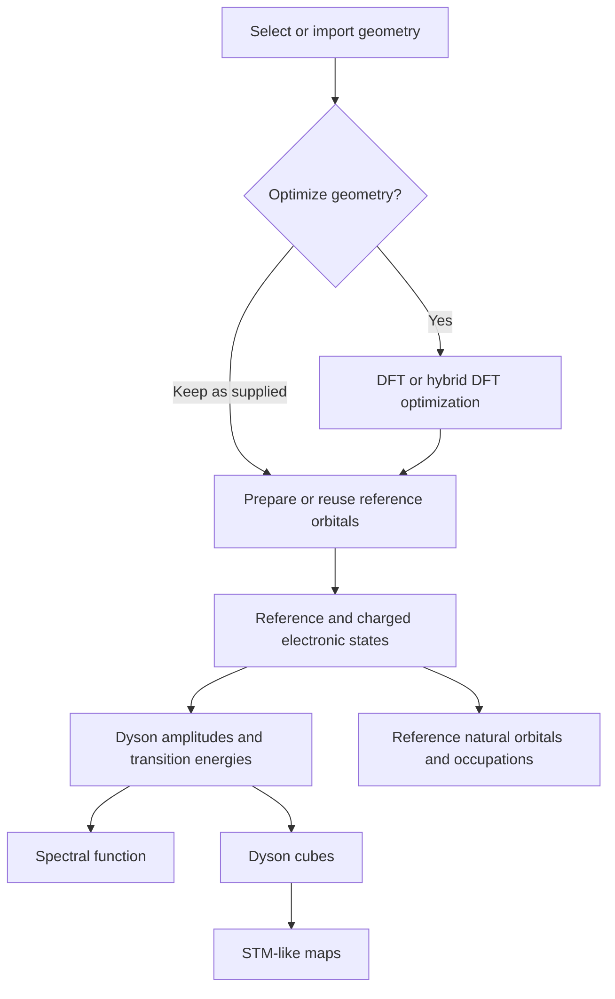

# AiiDAlab ORCA: molecular spectroscopy

**Status: discussion draft.** This repository is a place to agree on the scientific scope and user requirements before implementing an app or AiiDA workflows. The repository name is provisional. No workflows or app have been implemented here, and no scientific protocol described below should be treated as validated.

The intended application would let a researcher start from a molecular geometry, optionally optimize it with DFT or hybrid DFT, and calculate selected molecular properties such as natural orbitals, electron-addition/removal spectra, and Dyson-orbital maps. Existing compatible results should be reusable at every stage.

The immediate next step is to review this plan with [Andrés Ortega-Guerrero](https://github.com/AndresOrtegaGuerrero). Please keep initial feedback in the design-review issue under [Issues](https://github.com/nanotech-empa/aiidalab-orca/issues), referring to the relevant README section. This is a request for design and scientific review; it is not an assignment to implement the proposal.

## 1. Starting requirements

These requirements capture the initial discussion and are open to refinement with Andrés:

- Provide an AiiDAlab-QE-like flow: select a structure, configure the calculation and properties, review the execution plan, submit, and explore results.
- Allow the supplied geometry to be kept exactly as it is, including a geometry already optimized elsewhere or in a previous AiiDA calculation.
- Offer optional molecular geometry optimization using conventional DFT or hybrid DFT. Agree on supported methods and protocols before choosing defaults.
- Let the user request individual properties and return later to compute additional properties for the same structure.
- Reuse compatible calculations and their outputs whenever possible. Reuse must work across separate app sessions and independent workflow submissions.
- Explain which steps will run, which results will be reused, and why any calculation has to be repeated.
- Preserve the connection between structures, calculations, files, and derived results through AiiDA provenance.
- Build small, flexible scientific workflows that can be used separately and combined. Avoid one large workflow that owns every scientific task.

## 2. Scientific scope to agree

The initial motivating example combines three kinds of output:

1. Reference-state natural orbitals and their occupations.
2. An electron-addition/removal spectral function, with transition energies and Dyson pole strengths.
3. Individual or summed Dyson-orbital maps at selected heights above a molecule.

The supplied prototype uses a DFT reference followed by CASCI calculations for the reference electron count N and the charged sectors N−1 and N+1. The states are intended to share a common orbital basis. ORCA output and wavefunction JSON are then processed with `dyson-orca-tools`; Dyson cubes are used by `meqpy` to obtain constant-height STM-like maps.

This diagram describes dependencies, not a mandatory sequence to execute on every submission. A user with appropriate existing data should be able to enter at any relevant stage.

### First testing target: pentacene

**Pentacene is the agreed first system for design and subsequent testing.** The user-supplied starting geometry is included as [`examples/pentacene/pentacene.xyz`](examples/pentacene/pentacene.xyz). The XYZ contains 36 atoms (C22H14), all in the xy plane. This file has not yet been verified as an optimized geometry or as the exact geometry used in the publication.

The scientific reference is Kumar et al., *Multireference Theory of Scanning Tunneling Spectroscopy Beyond One-Electron Molecular Orbitals: Can We Image Molecular Orbitals?*, **J. Am. Chem. Soc. 147**, 24993–25003 (2025), [DOI: 10.1021/jacs.5c08166](https://doi.org/10.1021/jacs.5c08166) ([user-supplied article link](https://pubs.acs.org/jacsat/article/147/28/24993/3738262/Multireference-Theory-of-Scanning-Tunneling)).

The paper describes pentacene using closed-shell PBE0 reference orbitals and CASCI(12,12), and presents natural orbitals, Dyson orbitals, and strengths. Its simulated tunneling maps use PP-STM/PP-SPM. These are useful reference choices for discussion; the supplied M062X/CAS(14,14) setup and meqpy map model must not be assumed to reproduce that protocol automatically. [Paper and methods](https://pubs.acs.org/doi/10.1021/jacs.5c08166)

We should agree with Andrés on two levels of testing: an inexpensive pipeline check using the supplied pentacene structure, and a numerical comparison with the publication using matched geometry, electronic-structure settings, and map assumptions. The initial target is to compare reference occupations, transition energies and strengths, spectra, and selected map shapes. Exact settings, reference outputs, and acceptance tolerances remain to be established from the paper, its supporting information, and the discussion. Both keeping the supplied geometry and optionally optimizing it should be covered in the eventual workflow tests.

### Questions for scientific review

- Which pentacene geometry, basis, active orbitals, input settings, and numerical reference results should define the publication-comparison test?
- Should the first supported case be a singlet reference with doublet final states, a triplet with doublet/quartet final states, or both? The supplied command and illustrative figure use different reference multiplicities.
- Is the first release limited to CASCI in a shared orbital basis? Separately optimized CASSCF orbitals would require their own validation and reuse rules.
- How should the active orbitals be selected, inspected, and recorded? An active-space size such as CAS(14,14) alone does not identify the scientifically appropriate orbitals.
- Which functionals, basis sets, spin treatments, convergence criteria, and root counts are needed? Geometry optimization and reference-orbital preparation may intentionally use different protocols.
- Which reference root, energy-zero convention, spin factors, and spectral normalization should be used? Are only vertical transitions at a common geometry in scope initially?
- How should natural orbitals and occupations be obtained for a specific correlated reference state? These must be distinguished from the DFT orbitals used to initialize CASCI.
- What definition of tip height, molecular orientation, source slice, vacuum decay, and tip model is appropriate for the maps?

## 3. Small workflows with explicit interfaces

The preferred architecture is a collection of independently usable scientific components. Exact names and boundaries remain to be agreed.

| Candidate component | Responsibility | Reusable result |
| --- | --- | --- |
| Geometry optimization | Optimize a molecule with a selected DFT or hybrid DFT protocol. | Final structure, optimization history, convergence information. |
| Reference orbitals | Prepare the orbital basis required by the electronic-state calculations. | Orbital/checkpoint files, method settings, orbital metadata. |
| Electronic states | Compute a specified charge and multiplicity sector, with the requested roots and active space. | State energies, CI information, wavefunction data, orbital-basis identity. |
| Natural-orbital analysis | Obtain the selected reference state's natural orbitals and occupations. | Occupations, orbital coefficients, optional cubes. |
| Dyson analysis | Combine compatible initial and final states. | Transition identifiers, energies, strengths, Dyson coefficients. |
| Spectrum generation | Apply the selected broadening and energy alignment to a transition table. | Numerical spectrum and plotting metadata. |
| Cube generation | Evaluate selected orbitals on a recorded spatial grid. | Cubes with units, orientation, and grid metadata. |
| Map generation | Evaluate selected transitions or energy windows at specified heights. | Numerical maps and the settings needed to reproduce them. |

A thin orchestration layer may connect these components, resolve dependencies, and summarize their status. The scientific implementation belongs in the individual components. The components must also be callable outside the app.

A component is not necessarily a WorkChain: inexpensive deterministic transformations may be calculation functions, while external programs and substantial post-processing should run as CalcJobs, with WorkChains where orchestration or recovery is needed. We should agree on meaningful scientific boundaries rather than wrapping every shell command in its own workflow.

The graphical app should select and display results, and submit work through these interfaces. Closing a viewer must not interrupt an ongoing calculation.

## 4. Reuse depends on the requested operation

A result can be usable for one purpose but insufficient for another. For example, an archived optimized structure remains reusable after remote scratch is deleted, even if a wavefunction needed for a later electronic-state calculation has been lost.

For each requested operation, the backend should check both scientific compatibility and the availability of the specific inputs it consumes.

### Compatibility

- Keep an explicit link to the exact structure used, including atom ordering and relevant coordinate conventions. Retain the relationship between an input geometry and an optimized output geometry.
- Reuse of an unchanged, reimported structure can be supported through validated content matching. Molecular formula or approximate geometric similarity alone is insufficient.
- Check the relevant method, basis, charge, spin, active-orbital selection, reference root, computed roots, numerical settings, and software/file-format compatibility.
- Identify the common orbital basis used by the reference and charged CASCI states. Matching active-space sizes alone is insufficient.
- A geometry optimized with one method may be intentionally used for a different single-point method; this does not make the earlier electronic wavefunction an equivalent completed result.
- Link existing result data as inputs to new calculations. Preserve the original provenance and record new work in new nodes.

AiiDA calculation caching can support exact repeat submissions, but the proposed design also needs explicit selection of existing outputs and operation-specific file checks. WorkChains themselves are not cached. See the [AiiDA caching documentation](https://aiida.readthedocs.io/projects/aiida-core/en/stable/topics/provenance/caching.html).

### Availability and the execution plan

| Condition | Proposed behavior |
| --- | --- |
| Compatible results and required files are available | Reuse them. |
| Required files are preserved in AiiDA or a verified archive | Stage those files into the new calculation. |
| A missing derived file can be regenerated from preserved results | Run only the required post-processing. |
| A required file is confirmed missing and cannot be reconstructed | Identify the smallest scientifically consistent set of calculations to repeat. |
| A computer or archive is temporarily unreachable | Report availability as unknown; do not classify this as deleted data. |
| Existing results are incompatible with the request | Explain the mismatch and identify the necessary new calculations. |

The app should display this plan before submission, including an explanation for every repeated step. The backend must enforce the same rules when used without the app. File availability must be checked again when the files are consumed; a prior inspection cannot guarantee that remote scratch still exists.

If a new mandatory recalculation is discovered after submission, the workflow should report the changed plan instead of silently launching an expensive replacement. The exact recovery policy should be agreed during design.

If the original common orbital basis has been lost, recomputing it does not automatically make new and old CASCI states compatible. Restore the original basis where possible, validate compatibility, or recompute the affected set of states together. AiiDA caching must not bypass a regeneration request by returning the same unusable remote files.

## 5. What should survive scratch cleanup?

We should agree on a retention policy before defining workflow outputs. Candidate durable data include:

- Input and final structures, scientific settings, software versions, convergence information, and stable state identifiers.
- ORCA outputs containing the required CI coefficients and the relevant wavefunction JSON.
- Reference orbital/checkpoint files required to compute additional compatible electronic states.
- Transition energies, pole strengths, Dyson coefficients, and basis information sufficient for later spectrum and cube generation.
- Natural-orbital occupations and the corresponding orbital representation.
- Map parameters, coordinate transforms, units, and numerical outputs needed to reproduce exported figures.

File roles, sizes, checksums, formats, and producing calculations should be recorded. Storage location and current availability are separate from scientific identity. A remote path alone is not durable storage.

Large cubes may have a separate retention policy because they can often be regenerated from smaller retained data. We should measure real data sizes before deciding which wavefunction artifacts to keep by default. Imported results must record their actual source and must not imply that AiiDA executed the original calculation.

## 6. Spectra and map interpretation

The prototype notebook sums intensities for distinct final states. Its unnormalized Dyson cubes already carry pole-strength information; multiplying by the same strength again would double-count it.

The prototype normalizes each displayed panel independently. This is useful for comparing shapes, but hides brightness differences between transitions and heights. The app should preserve raw numerical maps and offer both individual and shared display scales.

For quantitative comparisons, we need explicit choices for spectral broadening, energy alignment, spin weighting, energy-window weighting, the vacuum-decay model, molecular orientation, and height origin. These maps should be presented with the assumptions of the selected STM-like model. A plain sum over selected states and a broadened energy-resolved map are different operations and should have distinct settings.

## 7. Prototype observations to verify before implementation

An initial source review on 13 October 2026 found the following integration points:

- The supplied setup script prepares DFT/CASCI calculations and `orca_2json` export. The separate `dyson_orca_tools prepare` and `spectrum` steps must be included in a complete pipeline.
- The supplied command uses a triplet reference, while the illustrative figure specifies a singlet reference.
- The notebook selects `_m1.cube` filenames, while the reviewed Dyson CLI names files by the final-state multiplicity. File discovery must agree with the producer and preserve state identity.
- At `dyson-orca-tools` commit `96658a681815faf1cf260bcb26fe712ca7715103`, the spectrum command overwrites its cube-grid settings with the energy grid before cube writing. A small mocked probe reproduced the resulting type error. This is a software integration observation, not a numerical validation of the scientific implementation.
- The script's per-process memory settings and total scheduler requests need reconciliation before submitting calculations.
- A pentacene starting geometry is now available and selected as the first testing target. Matched reference outputs and agreed scientific tolerances are still needed; saved notebook images alone do not establish numerical reproducibility.

These observations are inputs to the discussion, not an agreed implementation backlog. Recheck upstream code before preparing any fixes.

## 8. Proposed sequence after design agreement

1. **Agree on scope and reference data.** Resolve the scientific questions for pentacene, identify the first user stories, and decide the publication-comparison protocol and acceptance criteria with Andrés.
2. **Define component interfaces and retention.** Specify the structures, state data, files, and compatibility rules each component consumes and produces. Decide which existing packages own each part.
3. **Validate the scientific pipeline.** Use an inexpensive example and then an agreed reference dataset. Check energies, CI truncation, orbital compatibility, Dyson strengths, cube norms, natural occupations, and maps with agreed tolerances and conventions.
4. **Implement the reusable components and dependency planning.** Verify independent use, composition, file restoration, missing-data behavior, and recovery without a graphical app.
5. **Build the AiiDAlab interface.** Add structure selection, optional optimization, property selection, execution-plan review, monitoring, and result exploration.

No workflow implementation should start until the first design discussion has established what we want to support. There is no delivery schedule or finalized package topology yet.

Candidate acceptance cases for the eventual implementation:

| Request or event | Expected behavior |
| --- | --- |
| Change only spectral broadening | Recompute the spectrum without repeating electronic calculations. |
| Change only tip height or map display scale | Reuse the electronic results and available orbital data. |
| Request maps when cubes were deleted but coefficients and basis data remain | Regenerate cubes or the required grids without rerunning ORCA. |
| Add a charged-state multiplicity | Reuse compatible reference orbitals and existing sectors; calculate the missing sector and its transitions. |
| Request more roots than are stored | Explain which state calculations need extending or rerunning; do not assume a partial root set is sufficient. |
| Reuse a stored optimized geometry after scratch cleanup | Keep the geometry and regenerate only prerequisites that are actually missing. |
| Lose the common reference orbital file | Restore it, or report the scientifically consistent recalculation required. |
| Temporarily lose SSH access | Report an availability check failure, not deleted results. |
| Change a method or active-orbital selection | Reuse only unaffected compatible stages. |

## 9. Related software

- [dyson-orca-tools](https://github.com/AndresOrtegaGuerrero/dyson-orca-tools): Dyson orbitals, transition analysis, spectra, and cube generation.
- [meqpy](https://github.com/nanotech-empa/meqpy): the Dyson-to-map functionality used by the prototype notebook.
- [aiida-orca](https://github.com/ezpzbz/aiida-orca): a candidate ORCA calculation integration; support for the required input blocks, output artifacts, and recovery needs must be checked.
- [aiida-nanotech-empa](https://github.com/nanotech-empa/aiida-nanotech-empa): existing molecular and scanning-probe workflows and a possible home for shared components.
- [aiidalab-qe](https://github.com/aiidalab/aiidalab-qe): reference for the user-facing application flow.

Repository names, backend package boundaries, supported runtime versions, and release dependencies remain design decisions. The application should reuse maintained scientific packages rather than duplicate their numerical implementations.

This draft was prepared with Codex assistance from the initial discussion and source inspection. It awaits scientific and design review.
