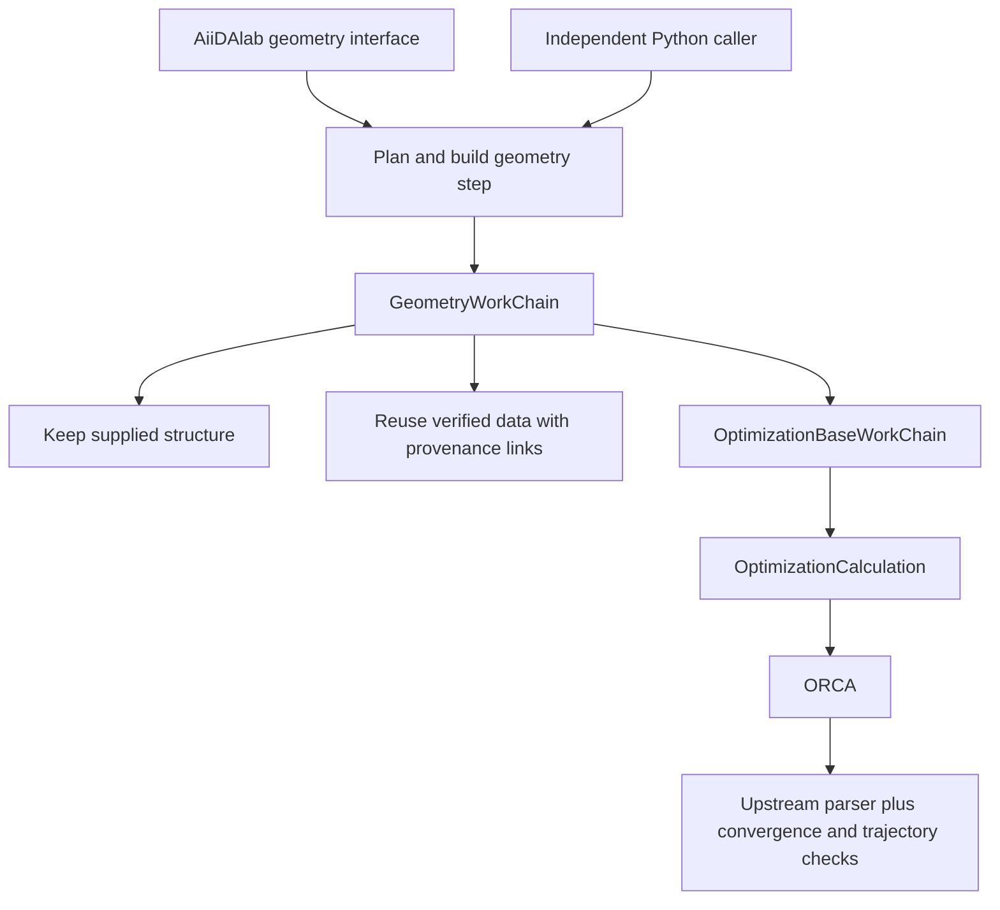

# Geometry prototype

The first milestone implements one molecular geometry step and a separate app.
It follows the scope agreed in [the design discussion](https://github.com/nanotech-empa/aiidalab-orca/issues/1).
The test molecule is neutral NO, multiplicity 2, starting at 1.30 Å.
Pentacene remains the later spectroscopy reference target.

## Components and existing work



- `backend/`: the separately installable `aiida-empa-orca` package. Its geometry
  WorkChain prepares, reuses, or optimizes one structure. It does not orchestrate
  spectroscopy.
- The CalcJob subclasses [`aiida-orca`](https://github.com/ezpzbz/aiida-orca), adding
  an explicit `%maxcore` input and trajectory retrieval. The base WorkChain
  subclasses upstream `OrcaBaseWorkChain` and retains its error handling.
  Upstream currently aborts known ORCA failures; this prototype does not claim
  automatic SCF or optimizer recovery.
- The parser extends the upstream parser, checks explicit geometry convergence,
  and stores trajectory and summary data. Normal ORCA termination alone is
  [not proof of optimization convergence](https://www.faccts.de/docs/orca/6.1/manual/contents/structurereactivity/optimizations.html).
- `src/aiidalab_orca/`: UI and short-lived ORM access. Widgets retain UUIDs and
  serialized values, not ORM nodes. The backend can be used without this package.
- [`aiida-common-workflows`' ORCA implementation](https://github.com/aiidateam/aiida-common-workflows/tree/600c4f231e96731a5256f01940cfcc6bdff26b82/src/aiida_common_workflows/workflows/relax/orca)
  was reviewed. It also wraps `orca.base`, but its protocols are PBE-only and its
  ORCA extra targets `aiida-orca~=0.6.0`. Following Carlo's direction, it is not
  used as a dependency or as the scientific protocol foundation.

## Local setup

Supported baseline: Python 3.12+, AiiDA 2.9.2+ within the upstream-supported 2.x
series, AiiDAlab 26.9.0+, ipywidgets 8. The modern EMPA support policy sets these
minimum versions; they are not claims that earlier releases necessarily fail.

```bash
python -m pip install -r requirements.txt
python -m pip check
```

ORCA is installed separately. Configure an `InstalledCode`, such as
`orca@localhost`, using its **absolute executable path**, the `orca.orca` input
plugin, and the required ORCA/Open MPI environment. Use `core.local` transport,
`core.direct` scheduling, and `with_mpi=False`: ORCA launches its own MPI workers
from `%pal`. This milestone deliberately supports local execution only.

After installing new entry points, refresh the AiiDA daemon at a suitable point
after checking existing work. Deploy this checkout as `~/apps/orca` (a symlink is
fine), then open `orca.ipynb` in AiiDAlab app mode. On the development instance:
`http://localhost:8888/apps/apps/orca/orca.ipynb`.

The tested ORCA 6.1.1 parser requires the unreleased
[`aiida-orca` PR 89 revision](https://github.com/ezpzbz/aiida-orca/pull/89)
`36abfa6917819c3e9ff454cfa89d9fd013634d12`, pinned in the backend metadata.
The released 0.7.0 parser failed on the ORCA 6.1.1 LEAN-SCF output in the local
water installation test (`IndexError` in `_append_scfvalues_scftargets`);
the pinned revision passed that test and the NO geometry tests.
Replace this development dependency only after testing an upstream release
containing the fix. No ORCA binary or wavefunction is distributed here.

## App flow

New sessions start without a selected molecule or prefilled coordinates. The
NO doublet test geometry is available through **Load NO doublet example**.
Calculation review is enabled after a structure has been selected.

The interface has three areas:

- **New calculation**: import a geometry, edit atoms, configure the calculation,
  and review whether it will compute, reuse a result, or keep the supplied geometry.
  Confirm the structure, confirm scientific settings, then choose resources and
  review the execution plan. Advanced scientific settings are collapsed initially.
- **Search calculations**: search all recorded ORCA geometry workflows by formula,
  label or UUID, with state, method and date filters and paginated results.
  Dates use Europe/Zurich. Select a run to check the stored data, view results,
  use its final geometry, or copy its settings onto the current input molecule.
  **Advanced search · open by UUID** opens a known workflow directly.
- **Results**: trajectory, SCF evaluation energies, final coordinates, method
  provenance and, when parsed, ⟨S²⟩; download XYZ or continue from the geometry.

The interface uses the shared `aiidalab-widgets-base.WizardAppWidget` and its
step states, following QE's confirmation, dependency, and back-navigation patterns.
Each step displays a prerequisite message until earlier steps are confirmed.
Navigation alone preserves a review; editing a structure invalidates both later
steps, changing science invalidates settings confirmation and the execution plan,
and changing resources invalidates only the plan. Validation uses the existing
backend rules and shows errors next to the affected controls. Submitted inputs
require **Edit a copy of these inputs** before another submission.

QE's application classes include QE-specific setup and calculation dependencies;
ORCA uses the common wizard and shared molecular widgets with a small adapter.
Status/results and history remain separate areas so previous work can be explored
while preparing a new calculation. The three draft steps correspond to QE's
structure, configuration, and resources/submission stages. Keeping a geometry
hides resource controls and requires no code; unused resource fields in the
backend's settings schema receive its defaults. No spin or method is guessed.

The home-page card provides icon launchers for **New calculation** (`orca.ipynb`)
and **Search calculations** (`search.ipynb`). Both load the AiiDA profile in a
separate first cell, before building the app. Results use NGL's trajectory controls
and keep detailed provenance and identifiers in an expandable section.

The structure step accepts one XYZ/Extended XYZ, CIF, PDB, MOL or SDF geometry,
searches existing `StructureData` from any AiiDA calculation, and reuses the EMPA
CDXML importer and widgets-base SMILES builder and atom editor. The viewer and
editor receive ASE data; search rows and callbacks retain UUIDs, never ORM nodes.
Select atoms in the viewer before using the atom editor. Reset restores the
imported geometry. Periodic inputs retain their periodicity until the user
explicitly selects **Treat as isolated molecule**; select/extract the appropriate
molecular fragment first. The ORCA backend rejects periodic input.

Unchanged AiiDA structures retain their existing UUID. Edits create a new structure
with the original linked as an input of `record_structure_edit`. File imports
record the original file as `SinglefileData`. CDXML imports use the shared
`record_cdxml_import` function, recording original/reviewed documents, chemical
interpretation, generation settings and whether the geometry was edited. These
records describe a user-reviewed starting model, not an ORCA energy optimization.
Changing CDXML generation settings invalidates the model and the submission
review until **Create model** is used again. Charge and multiplicity remain
explicit user choices for every importer.

The CDXML dependency is pinned to [EMPA widgets PR #12](https://github.com/nanotech-empa/aiidalab-widgets-empa/pull/12),
revision `8a85258bbb449ff99c1d0ee302fd4b6ae887c254`. The previously installed 0.2.2
release lacks its graph-validation and `cdxml_storage` APIs. That PR still reports
version 0.2.2, so a version-number constraint would not identify the required code.
This app consumes the canonical component revision; it does not modify the shared
PR stack or its runtime policy. Tests use widgets-base 3.0.0. The app's existing
Python/AiiDA/AiiDAlab support targets are unchanged.

Selecting a history result checks availability for each action. Missing optimization
files do not prevent use of an available final geometry. Unreachable storage is
reported separately from missing/invalid data. Matching formulae are search aids,
not scientific equivalence: the backend still performs its exact compatibility
and artifact checks during review and submission. Search does not query remote
scratch because this geometry operation needs no wavefunction.

## Protocols and expert settings

Scientific defaults live in the packaged
[`protocols/geometry.yaml`](../backend/src/aiida_empa_orca/protocols/geometry.yaml),
loaded with `yaml.safe_load`, following the `aiida-nanotech-empa` approach.
The YAML defines shared starting inputs and named, versioned protocol overrides.
The GUI and independent Python callers use the same definitions. **Apply defaults**
resets scientific overrides while preserving charge, multiplicity and resources.
Edits in the GUI affect only the current draft, never the YAML or an earlier run.
Changes to a published protocol should receive a new version identifier.

PBE/def2-SVP and PBE0/def2-SVP are the initial starting protocols. Their existing
scientific defaults are preserved: TightSCF, NormalOpt, no extra dispersion or
grid keyword. Suggestions include HF, PBE, PBE0, B3LYP and M062X (ORCA's spelling
of M06-2X); method and basis controls also accept typed ORCA names.

Charge and multiplicity are explicit and checked against nuclear electron count.
Automatic reference selection uses UHF/UKS for multiplicity >1 and RHF/RKS for
singlets; experts can choose an explicit compatible reference, including UKS
for a singlet. This choice alone does **not** construct a broken-symmetry state.
ROHF/ROKS, QRO and imported wavefunctions require further workflow support.
The automatic RI choice uses def2/J with RI-J for PBE and RIJCOSX for the listed
HF/hybrids, following the
[ORCA 6.1 RI documentation](https://www.faccts.de/docs/orca/6.1/manual/contents/essentialelements/RI.html).
Custom functionals and modified functional parameters require an explicit RI
choice; their exchange content is not guessed. Auxiliary basis, SCF/geometry
convergence, iteration limits, numerical grid and added dispersion are editable.
“No extra correction” does not remove dispersion intrinsic to a named functional.

Element rows assign orbital/auxiliary basis sets and optionally a named ECP or
`none` to remove one. Blank fields inherit the global choice. `NewGTO` does not
change an inherited ECP: the expert must choose a compatible pair, as explained
in the [ORCA basis documentation](https://www.faccts.de/docs/orca/6.1/manual/contents/essentialelements/basisset.html).
Overrides for elements absent from the molecule are rejected. The app does not
claim to validate ECP core sizes or basis availability; ORCA validates these.

Additional scalar parameter rows support `%scf`, `%geom` and `%method`, for
example `scf / TolE / 1e-8` or functional parameters from the
[ORCA DFT documentation](https://www.faccts.de/docs/orca/6.1/manual/contents/modelchemistries/DensityFunctionalTheory.html).
Numbers, booleans and single ORCA tokens are accepted. Dedicated procedure
controls cannot be overridden a second time in these rows. Nested blocks,
constraints, external basis files and MORead dependencies need separate typed
support; raw input injection is not a supported configuration path.

Review shows the effective settings, changes from the starting protocol, and
downloadable `aiida.inp`/`aiida.coords.xyz`. The preview shares the upstream ORCA
renderer and coordinate writer with the CalcJob. Results read the **actual stored
CalcJob input**, including the source calculation for reused results. Schema 2
records protocol identity and every resolved setting on the workflow, with the
effective ORCA parameters on its CalcJob. Legacy schema 1 remains readable and
compatible with equivalent protocol inputs; existing nodes are never rewritten.

Defaults: PBE/def2-SVP, neutral doublet, two processes, total memory budget 2048 MB,
100 geometry steps, 200 SCF steps, 30 minutes. `%maxcore` receives 75% of the total
memory budget divided by the process count. The direct scheduler cannot enforce
a hard physical-memory limit. These defaults define a small integration test,
not a validated production protocol for arbitrary molecules or spin states.
Convergence also does not establish a vibrational minimum or the lowest spin state.

## Backend API

```python
from aiida import load_profile, orm
from aiida.engine import submit
from ase.io import read
from aiida_empa_orca.workchains import get_builder, plan_geometry
from aiida_empa_orca.protocols import protocol_settings

load_profile()
structure = orm.StructureData(ase=read("examples/no/no.xyz"))
code = orm.load_code("orca@localhost")
settings = protocol_settings("pbe-v1", {"charge": 0, "multiplicity": 2})
plan = plan_geometry(structure, settings, code)
print(plan)  # Plain data: action, source UUID, missing-artifact explanations.
builder = get_builder(structure, settings, code, plan=plan)
node = submit(builder)
print(node.uuid)
```

Use `optimize=False` to keep the structure and record that decision without a
calculation. Use `force_recompute=True` in both planning and building to request
a fresh execution. `get_builder` plans automatically when `plan` is omitted.
The raw WorkChain accepts explicit reuse inputs; discovery belongs to this builder
API so previous data are linked as inputs before the new process starts.

Optimized outputs are `structure`, `trajectory`, `optimization_summary`,
`output_parameters`, and `retrieved`; a new calculation also returns its
`remote_folder`. Kept geometries return only `structure`. The `.gbw` remains on
scratch and is not required or retrieved by this geometry operation.

## Reuse and caching

Reuse compares ordered atom identities and exact coordinates, the effective
ORCA parameters, resources, and code UUID against successful geometry-workflow provenance.
Protocol labels do not affect compatibility when their effective inputs match;
every effective scientific override does. Values use AiiDA's storage precision.
Matching is deliberately conservative; even resource changes currently prevent
reuse. Code records must represent a fixed executable installation: replacing
a binary in place without changing its Code identity is outside this contract.

Required coordinates, trajectory arrays, convergence summary, parser results,
and retrieved geometry/output files are actually read. The scratch wavefunction
is irrelevant to this operation. The builder links reused data as explicit
`reuse.*` inputs, and the WorkChain verifies the source and data again before use.
If they disappear between review and consumption, the workflow fails and asks
for a new plan; it does not silently replace an agreed reuse with a calculation.

Discovery skips unavailable matching results and selects another usable result
when possible. Otherwise it proposes a fresh calculation and sets
`metadata.disable_cache=True` on the actual CalcJob. An explicit force request
does the same. Upstream restart inputs preserve that metadata on later attempts.
New calculation outputs are checked too. If a cache hit lacks required data,
the workflow executes that already-requested step once with caching bypassed;
a second failure stops instead of looping through cache hits.

This is cache-independent geometry reuse, **not yet a general electronic-artifact
resolver**. Remote GBW availability, restored retrieved wavefunctions, inaccessible
hosts versus deleted scratch, and minimal electronic regeneration belong to the
next backend components. They must follow the same operation-specific contract.

## Validation

Run isolated tests (no ORCA executable required):

```bash
AIIDA_PATH=/tmp/aiidalab-orca-test-state python -m pytest tests -q
```

The AiiDA fixtures create independent SQLite storage. Tests cover spin/geometry
validation, exact reuse compatibility, explicit reused-data links, missing
repository artifacts, keep-as-is, force/bypass propagation, and bounded recovery
from invalid cached data. Interface tests additionally cover search/filter pagination,
unchanged versus edited structure identity, original file/CDXML provenance, model
invalidation, explicit periodicity handling, and action-specific availability.
Wizard tests also check confirmation prerequisites, spin validation, back
navigation, downstream invalidation, keeping a geometry without a code,
submission retry, and prevention of accidental duplicate submission.
Use a fresh test-state directory in shared environments.

The real local integration command is `python examples/no/run_local.py`.
Validated on Linux ARM64, ORCA 6.1.1/Open MPI 4.1.8, Python 3.12.11, AiiDA 2.9.2,
AiiDAlab 26.9.0, ipywidgets 8.1.8 and nglview 3.0.8:

- Neutral NO doublet PBE/def2-SVP converged from 1.30 Å to approximately
  **1.160296 Å**, with energy **−129.660451904 Hartree**, ⟨S²⟩ **0.751398**,
  and six trajectory frames.
- PBE0/def2-SVP with RIJCOSX also converged through the app submission path
  (energy −129.650940226 Hartree, ⟨S²⟩ 0.752696).
- Explicit reuse launched no CalcJobs with caching enabled or disabled. Reuse
  remained available with the expected scratch GBW temporarily absent.
- Forced recomputation with caching enabled produced a fresh, uncached CalcJob
  carrying `metadata.disable_cache=True`.
- A real one-step optimization was rejected with CalcJob exit status 320.
- Browser-driven app submission produced a new optimization, then loaded its
  trajectory and energy viewer. Selecting its final geometry and submitting
  keep-as-is also passed, with no calculation and original provenance preserved.

The structure/history interface was additionally exercised in the browser: a
previous NO optimization was found and reused, its final geometry selected, and
an ethene CDXML uploaded and submitted with keep-as-is. The resulting workflow
retained the shared CDXML provenance record and launched no calculation.
Starting from an empty session, methane generated from SMILES `C` and a geometry
loaded from calculation history were also visually checked in the browser,
including returning to the viewer after changing tabs. The viewer is attached
when a structure is available, preventing a zero-size canvas on first use.

The guided flow was checked in fresh browser sessions without diagnostic kernel
commands before submission: SMILES methane (neutral singlet, PBE0/def2-SVP)
converged through a forced new calculation; file-imported NO reused an existing
optimization; CDXML ethene was kept unchanged. A separate search session reopened
the methane result, exercised NGL trajectory controls, reused its geometry,
copied settings, and moved one selected atom by 0.1 Å with the shared editor.
Keeping that edited structure created a linked edit record and no CalcJobs.
Both home-page icon links opened the intended app view. Automated tests also
ensure that repeated review preserves structure identity at AiiDA's storage
precision, while a real edit creates a new linked structure.

The YAML protocol/expert controls were tested in a fresh browser session:
the default protocol found a compatible legacy optimization, and a new neutral
NO doublet calculation used BP86/6-31G* with UKS/RI, a def2-TZVP override on N,
explicit `DelECP N`, and `scf.TolE = 1e-8`. It converged with a fresh uncached
CalcJob. Both previewed files matched the actual stored input byte for byte.
Reopening the result and copying its settings preserved the mixed basis and
SCF override, and review found the available optimization for reuse. The suite
contains 36 tests; the backend wheel was also checked for its packaged YAML.
This is an input/workflow integration test, not a recommendation of that model
or validation of heavy-element ECPs and arbitrary functionals.

These checks establish local workflow/UI integration. HF, B3LYP, M06-2X,
basis convergence, larger systems and numerical comparison to the pentacene
publication still need scientific validation. The app is a prototype for review.
