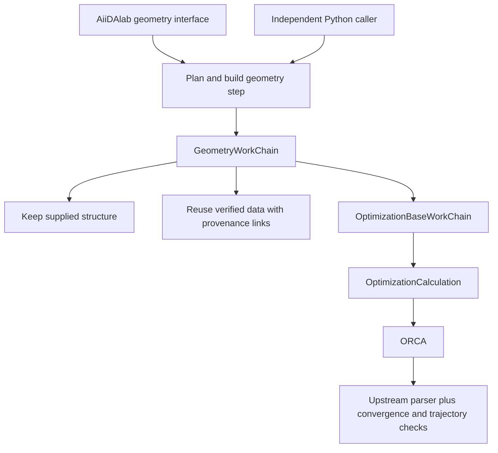

# Geometry prototype

The first milestone implements one molecular geometry step and a separate app.
It follows the scope agreed in [the design discussion](https://github.com/nanotech-empa/aiidalab-orca/issues/1).
The test molecule is neutral NO, multiplicity 2, starting at 1.30 Å.
Pentacene remains the later spectroscopy reference target.

## Components and existing work



- `backend/`: the separately installable `aiida-empa-orca` package. Its geometry
  WorkChain prepares, reuses, or optimizes one structure. It does not orchestrate
  spectroscopy.
- The CalcJob subclasses [`aiida-orca`](https://github.com/ezpzbz/aiida-orca), adding
  an explicit `%maxcore` input and trajectory retrieval. The base WorkChain
  subclasses upstream `OrcaBaseWorkChain` and retains its error handling.
  Upstream currently aborts known ORCA failures; this prototype does not claim
  automatic SCF or optimizer recovery.
- The parser extends the upstream parser, checks explicit geometry convergence,
  and stores trajectory and summary data. Normal ORCA termination alone is
  [not proof of optimization convergence](https://www.faccts.de/docs/orca/6.1/manual/contents/structurereactivity/optimizations.html).
- `src/aiidalab_orca/`: UI and short-lived ORM access. Widgets retain UUIDs and
  serialized values, not ORM nodes. The backend can be used without this package.
- [`aiida-common-workflows`' ORCA implementation](https://github.com/aiidateam/aiida-common-workflows/tree/600c4f231e96731a5256f01940cfcc6bdff26b82/src/aiida_common_workflows/workflows/relax/orca)
  was reviewed. It also wraps `orca.base`, but its protocols are PBE-only and its
  ORCA extra targets `aiida-orca~=0.6.0`. Following Carlo's direction, it is not
  used as a dependency or as the scientific protocol foundation.

## Local setup

Supported baseline: Python 3.12+, AiiDA 2.9.2+ within the upstream-supported 2.x
series, AiiDAlab 26.9.0+, ipywidgets 8. The modern EMPA support policy sets these
minimum versions; they are not claims that earlier releases necessarily fail.

```bash
python -m pip install -r requirements.txt
python -m pip check
```

ORCA is installed separately. Configure an `InstalledCode`, such as
`orca@localhost`, using its **absolute executable path**, the `orca.orca` input
plugin, and the required ORCA/Open MPI environment. Use `core.local` transport,
`core.direct` scheduling, and `with_mpi=False`: ORCA launches its own MPI workers
from `%pal`. This milestone deliberately supports local execution only.

After installing new entry points, refresh the AiiDA daemon at a suitable point
after checking existing work. Deploy this checkout as `~/apps/orca` (a symlink is
fine), then open `start.ipynb` in AiiDAlab app mode. On the development instance:
`http://localhost:8888/apps/apps/orca/start.ipynb`.

The tested ORCA 6.1.1 parser requires the unreleased
[`aiida-orca` PR 89 revision](https://github.com/ezpzbz/aiida-orca/pull/89)
`36abfa6917819c3e9ff454cfa89d9fd013634d12`, pinned in the backend metadata.
The released 0.7.0 parser failed on the ORCA 6.1.1 LEAN-SCF output in the local
water installation test (`IndexError` in `_append_scfvalues_scftargets`);
the pinned revision passed that test and the NO geometry tests.
Replace this development dependency only after testing an upstream release
containing the fix. No ORCA binary or wavefunction is distributed here.

## App flow

1. Upload/paste a single XYZ, or select an existing AiiDA StructureData UUID.
2. Choose optimization or keep-as-is; set method, basis, charge, multiplicity,
   convergence and local resources.
3. Review whether the step will compute, reuse an existing result, or keep the
   supplied coordinates. Editing settings invalidates the reviewed plan.
4. Submit to the daemon. Return later through the previous-runs list or a workflow
   UUID. View the trajectory, SCF evaluation energies, final coordinates, method
   provenance and, when parsed, ⟨S²⟩. Download XYZ or select the final geometry as
   the next input.

Choices are HF, PBE, PBE0, B3LYP, M06-2X; def2-SVP or def2-TZVP; NormalOpt or
TightOpt. Charge and multiplicity are explicit and checked against the electron
count. Multiplicity >1 uses UHF/UKS, while singlets use RHF/RKS. Broken-symmetry
singlets are outside this first interface. RI uses def2/J with RI-J for PBE and
RIJCOSX for HF/hybrids, following the
[ORCA 6.1 RI documentation](https://www.faccts.de/docs/orca/6.1/manual/contents/essentialelements/RI.html).
TightSCF is explicit. No dispersion correction is added implicitly.

Defaults: PBE/def2-SVP, neutral doublet, two processes, total memory budget 2048 MB,
100 geometry steps, 200 SCF steps, 30 minutes. `%maxcore` receives 75% of the total
memory budget divided by the process count. The direct scheduler cannot enforce
a hard physical-memory limit. These defaults define a small integration test,
not a validated production protocol for arbitrary molecules or spin states.
Convergence also does not establish a vibrational minimum or the lowest spin state.

## Backend API

```python
from aiida import load_profile, orm
from aiida.engine import submit
from ase.io import read
from aiida_empa_orca.workchains import get_builder, plan_geometry

load_profile()
structure = orm.StructureData(ase=read("examples/no/no.xyz"))
code = orm.load_code("orca@localhost")
settings = {"method": "PBE", "basis": "def2-SVP", "charge": 0, "multiplicity": 2}
plan = plan_geometry(structure, settings, code)
print(plan)  # Plain data: action, source UUID, missing-artifact explanations.
builder = get_builder(structure, settings, code, plan=plan)
node = submit(builder)
print(node.uuid)
```

Use `optimize=False` to keep the structure and record that decision without a
calculation. Use `force_recompute=True` in both planning and building to request
a fresh execution. `get_builder` plans automatically when `plan` is omitted.
The raw WorkChain accepts explicit reuse inputs; discovery belongs to this builder
API so previous data are linked as inputs before the new process starts.

Optimized outputs are `structure`, `trajectory`, `optimization_summary`,
`output_parameters`, and `retrieved`; a new calculation also returns its
`remote_folder`. Kept geometries return only `structure`. The `.gbw` remains on
scratch and is not required or retrieved by this geometry operation.

## Reuse and caching

Reuse compares ordered atom identities and exact coordinates, all normalized
settings, and the code UUID against successful geometry-workflow provenance.
Matching is deliberately conservative; even resource changes currently prevent
reuse. Code records must represent a fixed executable installation: replacing
a binary in place without changing its Code identity is outside this contract.

Required coordinates, trajectory arrays, convergence summary, parser results,
and retrieved geometry/output files are actually read. The scratch wavefunction
is irrelevant to this operation. The builder links reused data as explicit
`reuse.*` inputs, and the WorkChain verifies the source and data again before use.
If they disappear between review and consumption, the workflow fails and asks
for a new plan; it does not silently replace an agreed reuse with a calculation.

Discovery skips unavailable matching results and selects another usable result
when possible. Otherwise it proposes a fresh calculation and sets
`metadata.disable_cache=True` on the actual CalcJob. An explicit force request
does the same. Upstream restart inputs preserve that metadata on later attempts.
New calculation outputs are checked too. If a cache hit lacks required data,
the workflow executes that already-requested step once with caching bypassed;
a second failure stops instead of looping through cache hits.

This is cache-independent geometry reuse, **not yet a general electronic-artifact
resolver**. Remote GBW availability, restored retrieved wavefunctions, inaccessible
hosts versus deleted scratch, and minimal electronic regeneration belong to the
next backend components. They must follow the same operation-specific contract.

## Validation

Run isolated tests (no ORCA executable required):

```bash
AIIDA_PATH=/tmp/aiidalab-orca-test-state python -m pytest tests -q
```

The AiiDA fixtures create independent SQLite storage. Tests cover spin/geometry
validation, exact reuse compatibility, explicit reused-data links, missing
repository artifacts, keep-as-is, force/bypass propagation, and bounded recovery
from invalid cached data. Use a fresh test-state directory in shared environments.

The real local integration command is `python examples/no/run_local.py`.
Validated on Linux ARM64, ORCA 6.1.1/Open MPI 4.1.8, Python 3.12.11, AiiDA 2.9.2,
AiiDAlab 26.9.0, ipywidgets 8.1.8 and nglview 3.0.8:

- Neutral NO doublet PBE/def2-SVP converged from 1.30 Å to approximately
  **1.160296 Å**, with energy **−129.660451904 Hartree**, ⟨S²⟩ **0.751398**,
  and six trajectory frames.
- PBE0/def2-SVP with RIJCOSX also converged through the app submission path
  (energy −129.650940226 Hartree, ⟨S²⟩ 0.752696).
- Explicit reuse launched no CalcJobs with caching enabled or disabled. Reuse
  remained available with the expected scratch GBW temporarily absent.
- Forced recomputation with caching enabled produced a fresh, uncached CalcJob
  carrying `metadata.disable_cache=True`.
- A real one-step optimization was rejected with CalcJob exit status 320.
- Browser-driven app submission produced a new optimization, then loaded its
  trajectory and energy viewer. Selecting its final geometry and submitting
  keep-as-is also passed, with no calculation and original provenance preserved.

These checks establish local workflow/UI integration. HF, B3LYP, M06-2X,
basis convergence, larger systems and numerical comparison to the pentacene
publication still need scientific validation. The app is a prototype for review.
